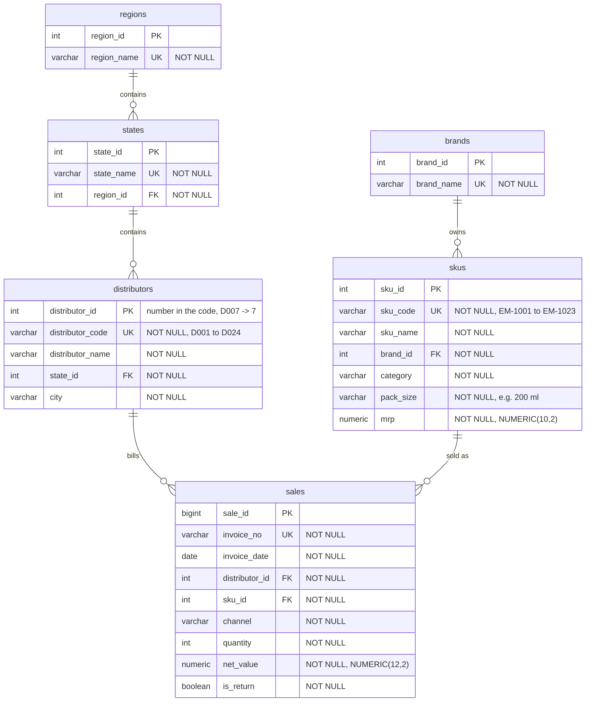

# Week 4 – Database ERD

Postgres schema for the Insights Hub. Five master (dimension) tables, seeded from
`week04_masters.xlsx`, and one fact table, `sales`, loaded from
`data_pipeline/output/clean_sales.csv`.

## How to read it

- `||--o{` means **one to many**: one region has many states, one SKU appears on many sales.
- **PK** = primary key, **FK** = foreign key, **UK** = unique (the natural key the seed
  script upserts on).

## Relationships

| From (many)             | To (one)                      | Meaning                          |
| ----------------------- | ----------------------------- | -------------------------------- |
| `states.region_id`      | `regions.region_id`           | each state belongs to one region |
| `distributors.state_id` | `states.state_id`             | each distributor is in one state |
| `skus.brand_id`         | `brands.brand_id`             | each SKU belongs to one brand    |
| `sales.distributor_id`  | `distributors.distributor_id` | who billed the sale              |
| `sales.sku_id`          | `skus.sku_id`                 | which product was sold           |

## Rules the schema enforces

- **Money is NUMERIC, never float**: `skus.mrp` is `NUMERIC(10,2)`, `sales.net_value` is
  `NUMERIC(12,2)`.
- **Returns check**: `CHECK ((is_return AND quantity < 0) OR (NOT is_return AND quantity > 0))`.
  A return must have a negative quantity; a normal sale must have a positive one.
- **Foreign keys** stop a sale from pointing to a distributor or SKU that does not exist.
- **Load order** (parents before children): regions → states → distributors → brands → skus → sales.

## What is not stored on `sales`

Region, state, distributor name, SKU name and brand are **not** columns on `sales`.
They come back through joins in the view `v_sales_denorm`, which returns the same shape
as the Week 3 API.
